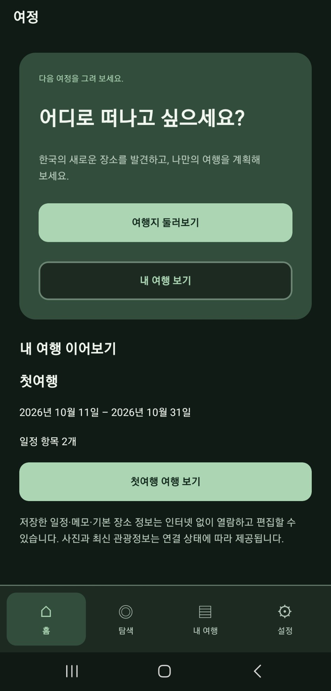
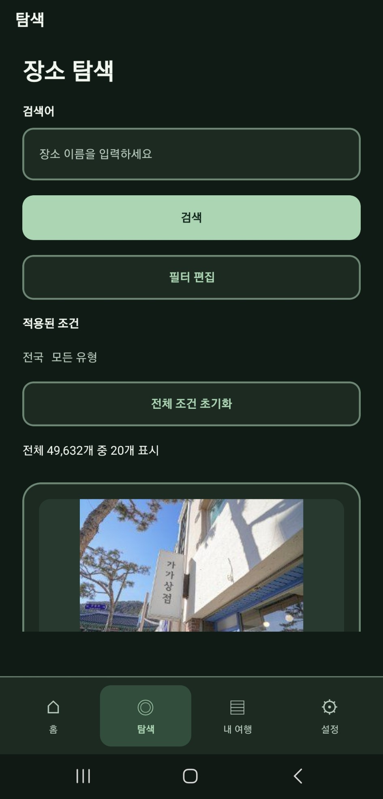
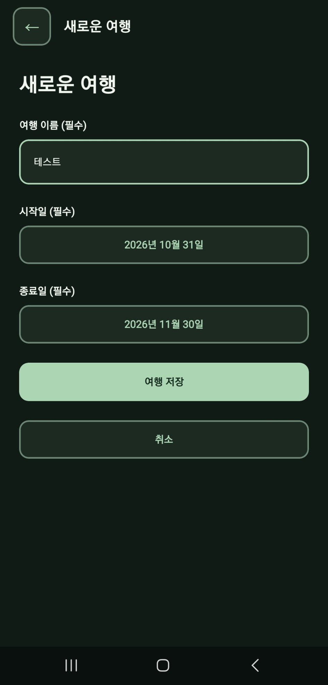
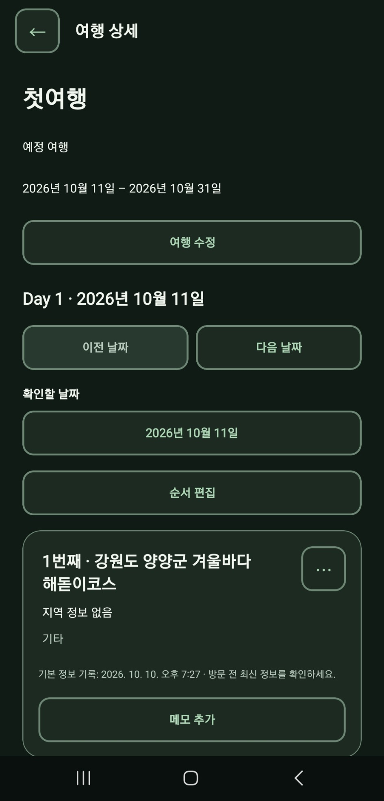

# Yeojeong · 여정

한국 여행지를 찾고, 저장하고, 날짜별 여행 일정을 만드는 앱입니다.
한국어·영어를 지원하며, 로그인 없이 여행과 메모를 기기에 저장합니다.
관광정보는 한국관광공사 TourAPI에서 가져옵니다.

## 화면

Android 앱의 한국어·다크 테마 화면입니다.

| 홈 | 탐색 |
| --- | --- |
|  |  |

| 여행 만들기 | 여행 일정 |
| --- | --- |
|  |  |

## 주요 기능

| 기능 | 할 수 있는 일 |
| --- | --- |
| 장소 탐색 | 전국·시도·시군구별 조회, 관광지·문화시설·음식점 목록 필터 |
| 검색·상세 | 키워드 검색, 사진·주소·이용 정보 확인 |
| 장소 저장 | 관심 장소 저장, 최근 본 장소와 검색어 관리 |
| 여행 계획 | 여행 기간 설정, 여러 지역의 장소를 날짜별로 추가 |
| 일정 편집 | 방문 순서 변경, 메모 작성, 여행 기간 변경 |
| 언어·테마 | 한국어·영어, 라이트·다크 |
| 오프라인 | 저장한 여행·순서·메모의 열람·편집, 기본 장소 정보 확인 |

키워드 검색에는 지역 필터만 적용합니다. 새 검색과 최신 상세 정보 조회에는 인터넷이 필요합니다.

## 집중한 세 가지

### 1. 언어를 바꿔도 여행 기록 유지

화면의 버튼·안내 문구와 API가 제공하는 관광정보의 언어를 따로 처리했습니다. 국문·영문 API의 장소 ID가 같다고 가정하지 않습니다. 번역 연결이 확인되지 않은 저장 장소는 저장 당시 정보와 원문 언어를 표시합니다.

큰 글씨, 버튼 설명, 모션 감소도 반영했습니다. 메모 편집에서는 오래된 초기 포커스 예약을 취소해 복귀 포커스와의 경쟁을 해결했습니다. 정상 흐름과 빠른 조작은 별도로 테스트했으며, 실제 TalkBack·VoiceOver 검증은 남아 있습니다.

### 2. 여러 화면에서 같은 UI 사용

색상·간격·글자 스타일을 공통 기준으로 관리하고 버튼·입력창·달력·오류 안내를 여러 화면에서 재사용합니다. 여행 생성과 기간 수정에서 같은 달력을 사용해 날짜 선택 규칙을 일관되게 적용했습니다.

### 3. 검색과 저장의 실패 처리

이전 검색이 늦게 끝나도 최신 결과를 덮어쓰지 않게 했습니다. 통신 실패 후 같은 검색어로 다시 검색할 수 있으며, 연속 제출의 중복 요청은 막습니다.

방문 순서나 여행 기간을 바꿀 때는 관련 데이터를 SQLite 트랜잭션으로 함께 저장합니다. 중간에 실패하면 변경 전 상태로 되돌리고, 기간 밖으로 밀려난 일정은 사용자가 이동·삭제를 선택합니다. 로컬 저장 데이터는 브라우저 재실행 후 복원까지 확인했습니다.

AI를 구현과 리뷰에 활용했고, 핵심 동작은 테스트로 확인했습니다.

## 검증

아래는 2026-10-10에 실행한 검증 기록입니다. 이번 문서 축약에서는 테스트를 다시 실행하지 않았습니다.

| 검증 | 기록된 결과 |
| --- | --- |
| 자동 테스트 | 103개 통과: 검색·날짜·저장·실패 복구 등. API는 목업, DB 통합 테스트는 실제 Node SQLite 사용 |
| 타입 검사·린트 | 통과 |
| 브라우저 E2E | 탐색 → 저장 → 여행 생성 → 편집 → 새 프로세스 재실행 복원 통과 |
| 웹 품질 검사 | 두 언어·테마, 좁은 화면, 글씨 모의 확대, 포커스·오류 처리 통과 |
| Android | 사용자가 빌드·실기기 동작 확인을 보고함. 최신 수정의 항목별 재검증은 필요 |
| iOS·네이티브 접근성 | 실기기 검증 필요 |

E2E는 사용 흐름을 자동으로 실행하는 테스트입니다. 브라우저 검증의 API·사진은 테스트용 데이터이며, 실제 기기의 동작을 대신하지 않습니다. 실제 API·사진 다운로드는 2026-10-08~09의 일부 표본 확인 기록이 있습니다. Android/iOS 릴리스 export 성공은 설치형 APK 동작 확인과 구분합니다.

## 기술

- React Native · Expo · TypeScript · Expo Router
- SQLite(기기 내 저장) · expo-image · expo-localization
- React Context · 자체 번역·요청 캐시 · Node 테스트 · 브라우저 E2E

## 실행

기존 확인 환경은 Node.js 24와 npm입니다.

```bash
npm ci
cp .env.example .env.local
```

`.env.local`에 TourAPI 인증키를 입력한 뒤 실행합니다. 국문·영문 키가 같으면 공통 키 하나를 사용합니다. 키가 다르면 예제의 `EXPO_PUBLIC_TOUR_API_KO_KEY`, `EXPO_PUBLIC_TOUR_API_EN_KEY`를 사용하며 전용 키가 우선합니다.

```dotenv
EXPO_PUBLIC_TOUR_API_KEY=발급받은_인증키
```

```bash
npm start
# 웹에서 화면 확인
npm run web
```

실제 키는 Git에 올리지 않습니다. `EXPO_PUBLIC_*` 값은 앱에 포함되므로 비밀로 숨겨지지 않습니다. 빈 `.env.example`만 복사하면 실제 관광정보 조회는 되지 않습니다.

### Android APK 만들기

자신의 EAS 프로젝트 연결과 `preview` 환경의 인증키를 준비합니다. 현재 `eas.json`은 내부 배포용 APK로 설정되어 있으며 EAS CLI 24.8.0 이상을 사용합니다.

```bash
npx eas-cli@24.8.0 login
npx eas-cli@24.8.0 build -p android --profile preview
```

### 검사 명령

```bash
npm run typecheck
npm run lint
npm test
```

브라우저 검증은 먼저 웹 결과물을 만듭니다. Chrome이 필요하며 두 검증을 순서대로 실행합니다.

```bash
npx expo export --platform web --output-dir dist
npm run test:e2e
npm run test:quality
```

기본 Chrome 경로는 macOS 기준입니다. 다른 환경에서는 `CHROME_BIN`을 지정합니다. 별도 웹 호스팅은 SQLite 실행에 필요한 WASM·Worker와 격리 헤더 설정이 필요합니다.

## 남은 과제

- 최신 APK의 재실행·비행기 모드·메모 편집과 기존 DB 업그레이드 확인
- iOS, TalkBack·VoiceOver, 실제 큰 글씨와 기기 성능 검증
- 국문·영문 장소 연결, 백업·내보내기 검토

사진·상세 설명 전체의 오프라인 사용은 보장하지 않습니다. 로그인·서버 동기화·백업은 없어 앱이나 저장 공간을 삭제하면 기록을 잃을 수 있습니다.

## 문서와 출처

- [제품 기능 기준](./docs/PRODUCT_SPEC.md)
- [개발·유지보수 규칙](./AGENTS.md)
- 관광정보·사진: [한국관광공사 TourAPI](https://api.visitkorea.or.kr/)
- 이미지 사용 시 출처와 [공공누리 이용 조건](https://www.kogl.or.kr/info/userGuide.do)을 확인합니다.
